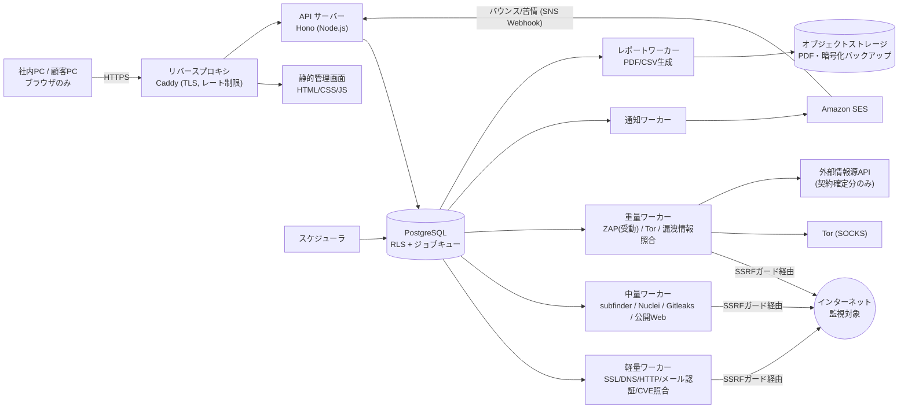

# DeepSec 全体設計書（実装前提出物）

- 版: 0.1（レビュー待ち・未承認）
- 調査日: 2026-11-11（OSS のライセンス・版数・API 利用条件は同日に公式情報で確認。「未確認」と記したものは確認できていない）
- 本書の承認後に実装を開始する。金額情報は仕様 22 章に従い記載しない。

---

## 1. 全体システム構成図

- クライアント PC はブラウザ表示のみ。監視・解析・保存・通知・PDF/CSV 生成はすべてサーバー側。
- 管理画面を閉じても、PC の電源を切っても、スケジューラとワーカーが監視を継続する。
- 各ワーカーは DB のジョブキューだけに依存する（相互に直接通信しない）ため、ワーカー種別ごとに別サーバーへ移設・増設できる。

## 2. 採用技術一覧

| 層 | 採用 | 理由 |
|---|---|---|
| 言語 | TypeScript (Node.js 22 LTS) | API・ワーカーで型と検証スキーマを共有 |
| API | Hono | 軽量。Node でも Cloudflare Workers でも動作し、将来の API 分離を妨げない |
| 入力検証 | Zod | API 入出力・ジョブペイロードの検証 |
| DB | PostgreSQL 17 | RLS、`FOR UPDATE SKIP LOCKED` によるジョブキュー |
| DB クライアント | node-postgres (pg) | パラメータ化クエリのみ使用。ORM なし |
| ジョブキュー | PostgreSQL 上の独自実装 | Redis 等を増やさない。構成要素とライセンス確認対象を最小化 |
| 認証 | 独自実装（Argon2id + TOTP + サーバー側セッション） | 4 ロールとテナント紐付けをサーバー側で厳密に制御 |
| フロント | 素の HTML/CSS/JS（フレームワークなし、ビルド不要） | メモリ 4GB 以下の PC 向け。グラフは必要画面のみ SVG を自前描画 |
| PDF | pdfmake（サーバー側） | ヘッドレスブラウザ不要で軽量 |
| メール | Amazon SES（AWS SDK v3）、SNS でバウンス・苦情受信 | 仕様 12-4 |
| スキャナ | Nuclei / subfinder / Gitleaks / OWASP ZAP | 5 章参照 |
| 実行基盤 | Linux + Docker Compose | 仕様 2-5 |
| リバースプロキシ | Caddy | 自動 TLS |
| CI | GitHub Actions + Syft/Grype + ライセンス許可リスト検査 | 仕様 5-3 |

## 3. OSS ライセンス一覧

許可リスト: MIT / Apache-2.0 / BSD-2-Clause / BSD-3-Clause / ISC / PostgreSQL License。
すべて「商用利用可・SaaS 組み込み可・改変可」。再配布時は著作権表示とライセンス文の同梱が必要（Apache-2.0 は NOTICE も）。`THIRD_PARTY_NOTICES` を CI で自動生成する。

### 3-1. 採用

| OSS | 公式 | 版（確認日時点の最新） | ライセンス | 用途 | 備考 |
|---|---|---|---|---|---|
| Nuclei | github.com/projectdiscovery/nuclei | v3.11.1 | MIT | 脆弱性診断 | 活発に保守 |
| nuclei-templates | github.com/projectdiscovery/nuclei-templates | v10.5.x | MIT | 診断テンプレート | 許可リスト方式で選別（6-3） |
| subfinder | github.com/projectdiscovery/subfinder | v2.17.0 | MIT | 受動的サブドメイン調査 | 各データソースの規約は別途確認。API キー不要ソースのみで開始 |
| Gitleaks | github.com/gitleaks/gitleaks | v8.30.1 | MIT | 認証情報検出 | 検出文字列は保存しない |
| OWASP ZAP | github.com/zaproxy/zaproxy | v2.17.0 | Apache-2.0 | 受動的診断 | 同梱アドオンのライセンスは導入時に Syft で再確認 |
| PostgreSQL | postgresql.org | 17.x | PostgreSQL License | DB | |
| Tor | torproject.org | 0.4.8 系 | BSD-3-Clause | Tor 上の公開情報取得 | 版数とライセンス文は導入時に再確認（今回は公式リポジトリの確認が不完全） |
| Hono | github.com/honojs/hono | 4.x | MIT | API | |
| node-postgres | github.com/brianc/node-postgres | 8.x | MIT | DB 接続 | |
| Zod | github.com/colinhacks/zod | 最新安定版 | MIT | 入力検証 | |
| @node-rs/argon2 | github.com/napi-rs/node-rs | 最新安定版 | MIT | パスワードハッシュ | |
| otpauth | github.com/hectorm/otpauth | 最新安定版 | MIT | TOTP (MFA) | |
| pdfmake | github.com/bpampuch/pdfmake | 最新安定版 | MIT | PDF 生成 | |
| AWS SDK for JS v3 | github.com/aws/aws-sdk-js-v3 | 3.x | Apache-2.0 | SES 送信 | |
| Caddy | github.com/caddyserver/caddy | 2.x | Apache-2.0 | TLS 終端 | |
| Syft / Grype | github.com/anchore | v1.57.1 / v0.121.3 | Apache-2.0 | SBOM・ライセンス検査・脆弱性検査 | |
| CrowdSec Security Engine | github.com/crowdsecurity/crowdsec | 最新安定版 | MIT | 自社 API の不正アクセス防御（任意） | エンジンのみ。共有ブロックリスト等のデータの商用組み込みは別契約のため使用しない |

「最新安定版」と記したライブラリは実装時にロックファイルで版を固定し、依存を含めて CI で検査する。

### 3-2. 不採用

| OSS | 理由 |
|---|---|
| Wazuh | GPLv2（一部 Apache-2.0）。仕様 5-1「GPL 系は原則不採用」に該当 |
| Greenbone Community Edition | スキャナ・テストは GPLv2、データオブジェクトは AGPLv3、フィードは ODbL |
| OnionScan | ライセンスが標準 SPDX に該当せず（GitHub 上「Other」）、リリースなし・最終更新 2024-08 で実質保守停止 |
| OWASP DefectDojo | BSD-3-Clause で条件は満たすが、テナント分離を別途作り込む必要があり構成が重い。検知の集約・重複排除・対応状況管理は自前の `security_events` で実装する |
| Redis | 近年のライセンス変更（RSAL/SSPL/AGPL）。キューは PostgreSQL で代替 |
| fail2ban | GPLv2 |
| ScanCode Toolkit / ORT | 条件は満たすが、Syft + 許可リスト検査で要件を満たせるため初期は見送り |

### 3-3. 判断が必要な点（要承認）

1. **実行基盤そのもののライセンス**: Linux カーネル（GPLv2）や OS 標準パッケージは、改変・再配布せず実行環境として利用するだけである。これを「採用 OSS」の対象外として扱ってよいか。対象外にできない場合、本システムは Linux 上で構築できない。
2. **日本語フォント**: PDF に日本語フォントの埋め込みが必要。Noto Sans JP は SIL OFL 1.1（商用利用・PDF 埋め込み可、事前許可不要）だが、仕様の優先ライセンス一覧にない。採用可否の承認が必要。
3. **Wazuh**: 上記 1 を認める場合、同じ理屈（無改変・内部利用のみ）で採用余地はある。認めない場合、自社サーバー監視は OS 監査ログ + 独自のファイル整合性チェック + CrowdSec で代替する（本書の既定はこちら）。

## 4. 外部 API 一覧と利用条件の確認結果

| 情報源 | 用途 | プラン | 確認結果 | 判定 |
|---|---|---|---|---|
| NVD API 2.0 | CVE 照合 | BASIC〜 | 利用可。画面とレポートに「This product uses the NVD API but is not endorsed or certified by the NVD.」の表示が必要。API キーありで 30 秒 50 リクエスト | 採用 |
| CISA KEV | 悪用確認済み脆弱性 | BASIC〜 | 公開 JSON フィード。ライセンス文書が公開されている（内容は導入時に全文確認） | 採用 |
| OSV.dev | OSS 脆弱性照合 | BASIC〜 | 公開 API。データは出典ごとにライセンスが異なり帰属表示が必要。今回は条文未確認 | 採用予定（導入時に条文確認） |
| 証明書透明性ログ等（subfinder 経由） | サブドメイン調査 | STANDARD〜 | ソースごとに規約が異なる | ソース単位で確認後に有効化 |
| GitHub REST API（コード検索） | 公開リポジトリの漏洩兆候 | STANDARD〜 | 認証必須、検索はレート制限が厳しい。規約の商用監視用途の条文は未確認 | 採用予定（規約確認後） |
| X など SNS 公式 API | SNS 監視 | STANDARD〜 | 有償契約と利用規約の個別確認が必要 | **契約確定まで本番不採用** |
| Have I Been Pwned | 漏洩 DB 照合・Infostealer ログ | PREMIUM | 有償。ドメイン検索は**ドメインごとに所有確認が必要**。規約で「HIBP データを単体の製品として第三者に提供・再販」することを禁止。第三者への表示には出典表示とリンクが必須。ドメイン数に上限あり | **契約・条件確認まで本番不採用**（当サービスの形態が再販禁止条項に抵触しないか HIBP への照会が必要） |
| ransomware.live | ランサムウェア公開リーク情報 | PREMIUM | **書面による事前承認なしの商用利用は禁止**。生データの再配布禁止、出典表示必須、30 分より短い間隔の取得は不可 | **承認取得まで不採用** |
| Tor 上の公開サイト（自前取得） | 公開リークサイト | PREMIUM | 技術的には可能。対象 URL は運営者が登録した許可リストのみ。取得するのは掲載の有無と概要だけ | 既定で無効。法務確認後に有効化 |
| Amazon SES / SNS | メール送信・バウンス | 全プラン | AWS 契約が必要 | 採用 |

外部情報源は共通アダプタ（取得・正規化・テナント別照合・レート制限・接続状態）として実装し、契約が確定した情報源だけを `external_api_settings` で有効化する。未契約・取得失敗の情報源は「未取得」と表示し、正常扱いにしない。

## 5. サーバー構成

初期は 1 台構成、Docker Compose で以下を起動する。

| コンテナ | 役割 | 分離時の移設先 |
|---|---|---|
| caddy | TLS 終端、静的ファイル配信 | CDN / Cloudflare |
| api | 認証、REST API、Webhook 受信 | Cloudflare Workers または別サーバー |
| scheduler | 定期ジョブの投入（1 インスタンスのみ、DB のアドバイザリロックで保証） | そのまま |
| worker-light | 軽量キュー | 台数追加 |
| worker-scan | 中量キュー（Nuclei・subfinder・Gitleaks 同梱イメージ） | 診断専用サーバー |
| worker-heavy | 重量キュー（ZAP 連携、Tor、漏洩照合） | ダークウェブ調査専用サーバー |
| worker-notify / worker-report | 通知・レポート | 台数追加 |
| zap / tor | ZAP デーモン、Tor SOCKS | worker-heavy と同居 |
| postgres | DB | マネージド PostgreSQL（Supabase 等） |

- 目安: 4 vCPU / メモリ 8GB / SSD 100GB 以上（ZAP が約 2GB を使用するため）。
- ネットワーク: DB は内部ネットワークのみ。スキャン系ワーカーは専用ネットワークに置き、ホストのファイアウォールでプライベート IP 帯・メタデータアドレスへの送信を遮断する（アプリ側 SSRF ガードとの二重防御）。
- ワーカーに Docker ソケットは渡さない。スキャナはワーカーイメージ内の実行ファイルを、引数を配列で渡して子プロセス起動する（シェル経由にしない）。

## 6. 監視ジョブ実行方式

### 6-1. キュー

`monitoring_jobs` を PostgreSQL のキューとして使用する。

- キュー種別: `light` / `medium` / `heavy` / `notify` / `report`
- 取得: `SELECT ... FOR UPDATE SKIP LOCKED`。ワーカーは一定間隔でハートビートを更新し、途絶えたジョブは回収して再試行する。
- 状態: `queued → running → succeeded | failed | timed_out | cancelled | deferred`
- 再試行: 指数バックオフ、上限回数あり。上限到達で運営管理者に通知。
- 冪等キー（対象・種別・予定時刻）で二重投入を防止。

### 6-2. リソース制御

- キュー別の同時実行数とジョブ種別ごとのタイムアウトを `monitoring_settings` で設定。
- ワーカーはジョブ取得前に CPU・メモリ・ディスク使用率を確認し、閾値超過時は取得を保留（`deferred`）する。
- 使用率は `system_logs` に定期記録し、管理画面の監視状況に表示する。

### 6-3. 結果の区別（監視失敗 ≠ 異常なし）

各チェックの結果は次の 3 値で `scan_results` に保存する。

| 値 | 意味 |
|---|---|
| `ok` | 取得に成功し、問題を確認しなかった |
| `finding` | 取得に成功し、問題を検知した |
| `error` | 取得・実行に失敗した（原因区分: dns / connect / tls / timeout / external_api / tool / internal） |

`error` は検知の「解消」判定に使わない。レポートと画面には「未取得」として監視停止期間とともに表示する。

### 6-4. Nuclei テンプレートの選別

- 既定で全実行しない。**許可リスト方式**とし、仕様の分類 1（情報取得型）・2（軽度の検査型）に該当するものだけを登録する。
- 機械的な除外: `intrusive` / `dos` / `fuzz` / `bruteforce` 等のタグ、`code`・`headless` プロトコル、対話型外部通信を要するもの。
- 分類 3 は顧客の明示許可を記録したドメインに限り、運営者が個別に有効化。分類 4 は登録不可。
- テンプレートの版を固定し、更新時は差分を確認してから許可リストへ追加する。
- レート制限・同時接続数を低く固定し、内部アドレス宛て通信の制限オプションを有効にする。

### 6-5. スキャン実行の前提条件

`domains.verification_status = verified` かつ契約状態が有効な場合だけ、能動的な通信を伴うジョブを投入する。ジョブ実行直前にも再確認する。ZAP は受動スキャンのみ。能動スキャンは顧客の許可記録があるドメインに限定する。

## 7. DB 設計

共通: 主キーは UUID、時刻は `timestamptz`。顧客関連テーブルはすべて `tenant_id NOT NULL` と RLS を持つ。

| テーブル | 主な列 | 備考 |
|---|---|---|
| tenants | id, name, contact_name, email, phone, status, created_at | 顧客 |
| users | id, email, password_hash, mfa_secret_enc, mfa_enabled, system_role, status, failed_logins, locked_until | system_role: admin / operator / null |
| roles | id, code, description | system_admin / operator / tenant_admin / tenant_user |
| tenant_members | tenant_id, user_id, role_id | 顧客ユーザーの所属。運営担当者の担当顧客もここで管理 |
| sessions | id_hash, user_id, mfa_verified, expires_at, ip, user_agent | 仕様の最低限一覧に追加 |
| subscriptions | tenant_id, plan, status, started_at, ended_at | 金額列なし |
| plan_features | plan, feature_key, enabled, limits(jsonb) | プラン別機能制御。管理画面から変更可 |
| domains | tenant_id, hostname, verification_status, scan_consent_level, active | |
| domain_verifications | tenant_id, domain_id, method, token_hash, status, verified_at, verified_by | dns_txt / html_file / email / manual |
| monitoring_settings | tenant_id (null=全体既定), key, value(jsonb) | 間隔・同時実行数など |
| monitoring_jobs | tenant_id, domain_id, queue, job_type, status, run_at, attempts, locked_by, heartbeat_at, idempotency_key | キュー本体 |
| monitoring_job_logs | tenant_id, job_id, level, error_category, message, created_at | 実行ログ |
| scan_results | tenant_id, job_id, domain_id, check_type, outcome, summary(jsonb), observed_at | ok / finding / error |
| security_events | tenant_id, domain_id, event_type, severity, source_id, title, detail, url, confidence, recommendation, status, assignee_id, fingerprint, state, first_seen_at, last_seen_at, resolved_at | fingerprint は (tenant, domain, type, 正規化キー) のハッシュで一意。state: new / ongoing / resolved |
| event_sources | id, code, name, kind, attribution_text, coverage_note | 情報源の範囲・更新頻度・出典表示 |
| event_status_histories | tenant_id, event_id, from_status, to_status, changed_by, note, created_at | 対応履歴 |
| notifications | tenant_id, event_id, audience, recipient, template, status, attempts, next_attempt_at, dedupe_key | 通知キュー。audience: operator / customer |
| notification_logs | tenant_id, notification_id, attempt, result, provider_message_id, delivery_status, created_at | 送信成功と到達（バウンス・苦情）を分けて記録 |
| report_settings | tenant_id, auto_send, recipients, cc, send_day, send_time, attach_pdf, pending_recipients, confirm_token_hash | 宛先変更は確認完了まで pending |
| monthly_reports | tenant_id, period_start, period_end, status, summary(jsonb), storage_key, sent_at | |
| external_api_settings | id, source_id, enabled, secret_ref, limits(jsonb), contract_status, last_ok_at, last_error | 秘密情報そのものは保存せず参照名のみ |
| audit_logs | tenant_id (null 可), actor_id, action, target_type, target_id, ip, meta(jsonb), prev_hash, hash, created_at | 追記のみ。ハッシュ連鎖で改ざん検知 |
| system_logs | level, component, message, meta(jsonb), created_at | 運営専用 |

保存しないもの: 認証情報の原文、パスワード、秘密鍵、漏洩データの原文。Gitleaks 等の検出値はマスク済み文字列（先頭数文字 + 伏字）と検出位置・出典・日時だけを保存する。

## 8. 顧客データ分離設計

1. **DB ロールの分離**
   - `app_api`: API 用。RLS 適用、`BYPASSRLS` なし。
   - `app_worker`: ワーカー用。同じく RLS 適用。ジョブごとにテナントを設定して処理する。
   - `app_admin`: マイグレーション専用。アプリからは使用しない。
2. **RLS**: 全顧客関連テーブルで `ENABLE` + `FORCE ROW LEVEL SECURITY`。ポリシーは `tenant_id = current_setting('app.tenant_id')::uuid`、または運営ロール（`app.role` が admin、もしくは operator かつ `tenant_members` に担当登録あり）。
3. **リクエスト処理**: セッションからユーザーを特定 → `tenant_members` で所属を検証 → トランザクション内で `SET LOCAL app.user_id / app.tenant_id / app.role` を設定。リクエスト中の顧客 ID は「所属の中からの選択」としてのみ扱い、それだけでは許可しない。
4. **アプリ層の認可**: ルートごとにロールを宣言。RLS と二重に検査する。
5. **通知・レポート**: テナント単位のジョブとして生成し、クエリは必ずテナント設定済みトランザクションで実行。運営向けと顧客向けはテンプレートも宛先解決も別経路にする。
6. **ストレージ**: オブジェクトキーを `tenants/{tenant_id}/...` とし、ダウンロードは API が認可後に中継する（公開 URL を発行しない）。
7. **テスト**: 「顧客 A のセッションで顧客 B の ID を指定した全 API が拒否される」ことを統合テストで網羅する。RLS 単体のテストも用意する。

## 9. 通知処理設計

- 検知の保存（`security_events`）と通知（`notifications`）は別トランザクション・別ワーカー。メール送信が失敗しても検知は残る。
- 通知対象: 状態が `new` になったとき、重要度が上がったとき、`resolved` になったとき。`ongoing` の再検知では通知しない（`dedupe_key` で抑制）。
- 再送: 失敗後 5 分 → 30 分 → 2 時間。最終失敗で運営管理者に通知し、ダッシュボードの通知失敗数に計上。
- 送信結果: SES の受付成功を `sent`、SNS 経由のイベントで `delivered / bounced / complained` を別途記録。バウンス・苦情の宛先は抑止リストに登録。
- 本文: 検知日時・顧客名・ドメイン・種別・重要度・情報源・概要・推奨対応・管理画面リンクのみ。認証情報や機密値は載せない。HTML とテキストの両形式。
- 送信元: 専用サブドメイン。異常通知と月次レポートで送信元アドレスを分離。SPF・DKIM・DMARC（`p=none` から段階的に強化）。

## 10. 月次レポート

- スケジューラが顧客ごとの送信日時に `report` ジョブを投入。集計 → `monthly_reports` 保存 → PDF 生成 → ストレージ保存 → 送信ジョブ投入。
- 集計項目: 監視実施状況（成功・失敗・未取得）、検知件数、重要度別、新規・継続・解消、未対応、前月比、推奨対応、総合コメント（ルールベースの定型文）。
- 検知なしの場合の定型文:「今回の監視対象および取得可能な情報源の範囲内では、新規の異常を確認していません。」未取得の情報源・監視停止期間があれば必ず併記する。「安全」「問題なし」と断定する文言はテンプレートに含めない。
- 必要な出典表示（NVD 等）をフッターに記載。

## 11. セキュリティ対策一覧

| 区分 | 対策 |
|---|---|
| 通信 | HTTPS 必須、HSTS、TLS 1.2 以上 |
| 認証 | Argon2id、TOTP による MFA（運営ロールは必須）、ログイン試行制限とロック、セッション ID はハッシュ化して DB 保存 |
| セッション | `HttpOnly` / `Secure` / `SameSite=Strict` Cookie、アイドル・絶対タイムアウト、権限変更時に失効 |
| CSRF | SameSite に加え、Origin 検証と CSRF トークン |
| XSS | 厳格な CSP（インラインスクリプト禁止）、DOM 挿入は `textContent` のみ、出力エスケープ |
| SQL インジェクション | パラメータ化クエリのみ |
| 認可 | ルート単位のロール宣言 + RLS |
| SSRF | 専用モジュールに集約。スキーム・ポート許可リスト、名前解決後の全 IP を検査（ループバック、プライベート、リンクローカル、CGNAT、メタデータ、IPv4 射影 IPv6 等を拒否）、**検査済み IP に固定して接続**（DNS Rebinding 対策）、リダイレクトは手動追跡で毎回再検査、タイムアウト、応答サイズ上限。加えてホスト側の送信フィルタ |
| 秘密情報 | 環境変数または Secret Manager から取得。DB には参照名のみ。フロント・リポジトリに置かない。CI で Gitleaks を実行 |
| データ保護 | ディスク暗号化、MFA シークレット等は列単位で暗号化、バックアップ暗号化 |
| 監査 | 追記専用の `audit_logs`（UPDATE/DELETE 権限なし、ハッシュ連鎖）、機密値はログに出さない |
| レート制限 | API 全体と認証系に個別設定 |
| 依存関係 | CI で Grype（脆弱性）と Syft + 許可リスト（ライセンス）。違反時はビルド失敗 |
| 自社基盤監視 | OS 監査ログ、ファイル整合性チェック、CrowdSec（任意） |
| バックアップ | 日次の論理バックアップを暗号化して別保存先へ。復元テスト用スクリプトと手順書を用意 |
| 基準 | OWASP ASVS 5.0.0 を参照。リリース前に第三者診断を推奨 |

## 12. 開発上のリスク

| リスク | 影響 | 対応 |
|---|---|---|
| PREMIUM の情報源が契約前 | 漏洩照合・ダークウェブ監視が本番で動かない | アダプタとテスト用スタブまで実装。契約確定後に接続 |
| SNS 公式 API の条件・費用 | SNS 監視の範囲が限定される | GitHub 公開コード検索と公開 Web から開始 |
| 外部観測によるバージョン特定の不確実性 | CVE 照合の誤検知・見逃し | 判定確度（high / medium / low）を付与し、低確度は重要度を上げない |
| Nuclei テンプレートの安全性 | 顧客サイトへの意図しない影響 | 許可リスト、版固定、低レート |
| 認証の独自実装 | 実装不備が致命的になる | 実績あるライブラリのみ使用、ASVS に沿ったテスト、第三者診断 |
| 1 台構成 | 単一障害点 | 外形監視、バックアップ、復旧手順書。分離可能な構成を維持 |
| 重量スキャンのメモリ使用 | サーバー負荷 | 重量キューの同時実行 1、負荷時は保留 |
| Tor 経由取得の法務リスク | 違法コンテンツへの接触 | 既定で無効、許可リスト、原文を保存しない、法務確認を前提 |

## 13. 実装できない機能・制約事項

1. **ダークウェブ全体の監視、すべての漏洩の検知、完全リアルタイム検知は実現できない。** 契約した情報源と登録した公開サイトの範囲に限られる。画面・レポートには情報源ごとの対象範囲・更新頻度・取得遅延を表示する。
2. **PREMIUM の漏洩情報照合は、外部契約が完了するまで本番稼働できない。** HIBP は再販禁止条項との適合確認とドメインごとの所有確認が必要。ransomware.live は書面承認が必要。
3. **SNS 監視は公式 API 契約の範囲に限られる。** 規約を回避する取得は実装しない。
4. **Wazuh・Greenbone・OnionScan はライセンスまたは保守状況の条件を満たさず採用しない。** Greenbone 相当のネットワーク層の網羅的診断は初期範囲に含まれない。
5. **製品バージョンの外部観測は不確実。** 公開脆弱性情報の照合結果は確度付きの「可能性」として提示する。
6. **メール到達の保証はできない。** 送信受付とバウンス・苦情の把握までが範囲。
7. **この開発環境から検証できないもの**: 実サーバーへのデプロイ、SES の実送信、Tor 接続、外部有償 API、4GB PC での実機動作。これらは手順書と自動テスト（スタブ使用）を用意し、実環境での受入確認が別途必要。
8. 料金・請求・決済は対象外（仕様 22 章）。

## 14. 承認いただきたい事項

1. 構成: 初期は 1 台の Linux サーバー + Docker Compose（DB 同居）で開始し、後から API・DB を分離できる形でよいか。（代替: 最初から Cloudflare Workers + Supabase）
2. ライセンス方針: 3-3 の 1（Linux 等の実行基盤）と 2（Noto Sans JP / OFL 1.1）を認めるか。
3. 認証: 独自実装（Argon2id + TOTP）でよいか。
4. 外部契約: HIBP・ransomware.live・SNS API の照会と契約は貴社側で進める前提でよいか。確定までは該当機能をスタブ接続で実装する。

## 15. 実装順（承認後）

仕様 20-1 の順に従う: DB → 認証・権限 → 顧客管理 → 所有権確認 → ジョブ管理 → 基本監視 → 脆弱性診断 → 公開 Web 監視 → 漏洩情報監視（アダプタ）→ 検知管理 → 通知 → 月次レポート → 管理画面 → 監査ログ → バックアップ → セキュリティテスト。
